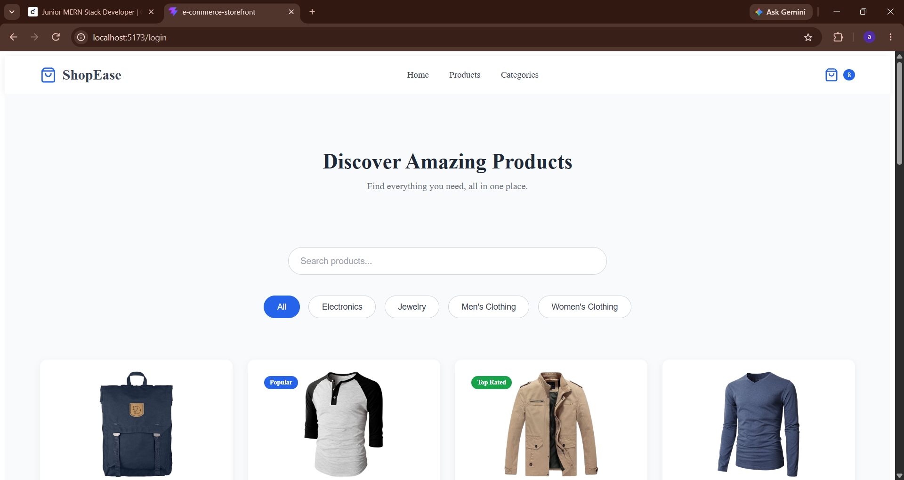
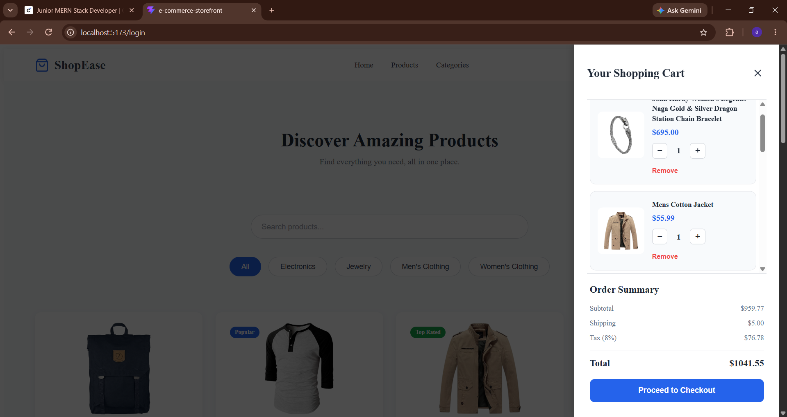

# 🛍️ ShopEase – E-Commerce Storefront

ShopEase is a responsive e-commerce storefront built with React and JavaScript. It allows users to explore products, search and filter categories, manage a shopping cart, and complete a simulated checkout process.

The application fetches sample product data from FakeStoreAPI.

## ✨ Features

- **Product Listing:** Fetch and display products dynamically from an external API.
- **Product Cards:** Display product images, prices, ratings, and product badges.
- **Search:** Search products by name.
- **Category Filtering:** Filter products by electronics, jewelry, and clothing.
- **Shopping Cart:** Add, remove, and manage products.
- **Quantity Management:** Increase or decrease product quantities.
- **Cart Calculations:** Automatically calculate subtotal, shipping, tax, and total.
- **Cart Persistence:** Preserve cart items using localStorage, even after refreshing the page.
- **Checkout:** Simulated checkout with customer details and order confirmation.
- **Responsive Design:** Optimized layouts for desktop, tablet, and mobile devices.
- **Loading and Error States:** Provide feedback while fetching products or when an API request fails.

## 🛠️ Technologies Used

| Technology | Purpose |
|---|---|
| React | Building the user interface |
| JavaScript (ES6+) | Application logic |
| Vite | Development server and build tool |
| CSS3 | Styling and responsive design |
| React Hooks | Component state and lifecycle management |
| FakeStoreAPI | Product data |
| Lucide React | Icons |
| localStorage | Cart persistence |
| Git & GitHub | Version control |

## 📂 Project Structure

```text
E-commerce-storefront/
│
├── public/
├── src/
│   ├── components/
│   │   ├── Header.jsx
│   │   ├── Hero.jsx
│   │   ├── ProductCard.jsx
│   │   ├── ProductList.jsx
│   │   ├── SearchBar.jsx
│   │   ├── CategoryFilter.jsx
│   │   └── CartDrawer.jsx
│   │
│   ├── App.jsx
│   ├── main.jsx
│   └── index.css
│
├── .gitignore
├── index.html
├── package.json
└── vite.config.js
```


## 📸 Application Screenshots

### Homepage


### Shopping Cart


## 🚀 Getting Started

Follow these steps to run ShopEase locally.

### 1. Clone the repository

```bash
git clone https://github.com/asyashim/Datheon_Full_Stack_Web_Development_Internship.git
```

### 2. Navigate to the ShopEase folder

```bash
cd Datheon_Full_Stack_Web_Development_Internship/E-commerce-storefront
```

### 3. Install dependencies

```bash
npm install
```

### 4. Start the development server

```bash
npm run dev
```

Open the local URL displayed in your terminal.

### 5. Build for production

```bash
npm run build
```

## 🌐 API Integration

ShopEase uses **FakeStoreAPI** to fetch product information, including:

- Product title
- Product image
- Price
- Category
- Rating

## 🛒 Checkout Information

The checkout process is simulated for demonstration purposes.

Users can enter their name and email address and receive an order confirmation. No actual payment processing or backend order creation is implemented.

## 📱 Responsive Design

ShopEase supports:

- Desktop screens
- Tablets
- Mobile devices

## 🎯 Project Purpose

This project was developed as part of the Datheon Full Stack Web Development Internship to practise React, API integration, state management, shopping cart functionality, and responsive web design.