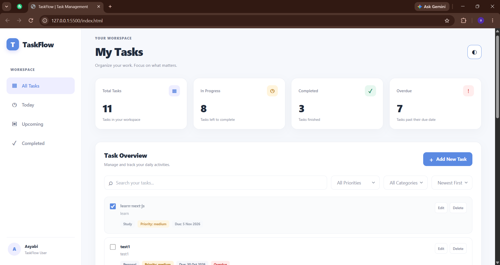
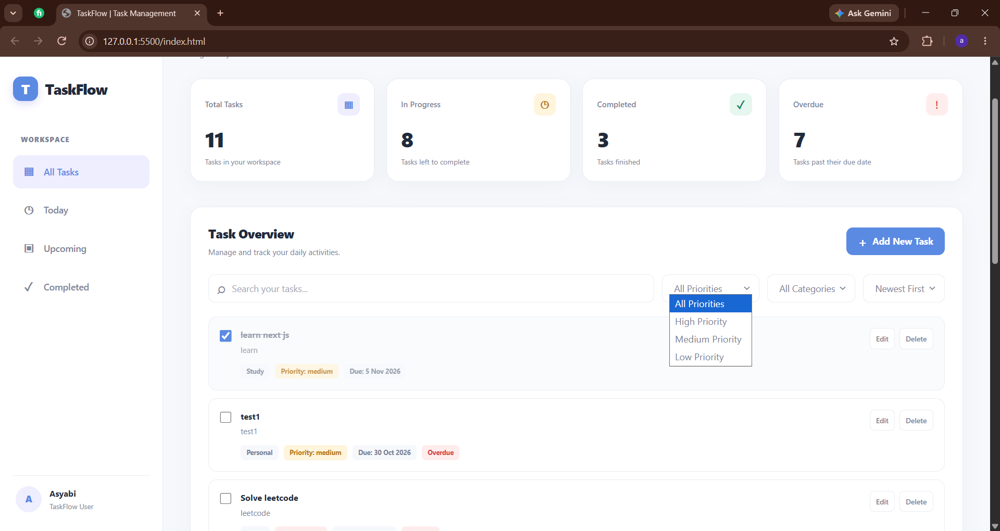
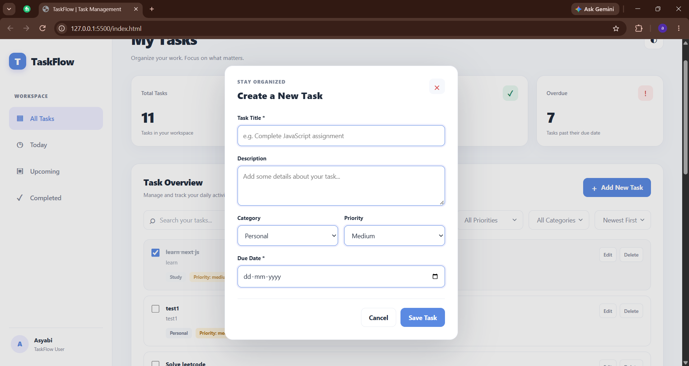

# ✅ TaskFlow – Task Management System

TaskFlow is a simple and interactive task management application designed to help users organize their daily activities, manage priorities, and track their progress.

The application provides an intuitive interface for creating, updating, completing, and managing tasks efficiently.

## ✨ Features

- **Task Management:** Create, edit, and delete tasks.
- **Task Categories:** Organize tasks into Work, Personal, and Study categories.
- **Priority Management:** Assign priorities to tasks.
- **Due Dates:** Set deadlines and identify overdue tasks.
- **Task Status:** Mark tasks as completed or pending.
- **Search:** Find tasks quickly using keywords.
- **Filtering:** Filter tasks based on category, priority, and status.
- **Sorting:** Sort tasks by newest, oldest, due date, and priority.
- **Quick Views:** View all tasks, today's tasks, upcoming tasks, and completed tasks.
- **Due Date Indicators:** Visual badges to identify task deadlines.
- **Dark Mode:** Switch between light and dark themes.
- **Data Persistence:** Save tasks using browser localStorage.
- **Form Validation:** Prevent invalid task submissions.
- **Delete Confirmation:** Confirm before deleting tasks.

## 🛠️ Tech Stack

- HTML5
- CSS3
- JavaScript (ES6+)
- Browser localStorage

## 🚀 Getting Started

### 1. Clone the Repository

git clone https://github.com/asyashim/Datheon_Full_Stack_Web_Development_Internship.git

### 2. Navigate to the Project Folder

cd Datheon_Full_Stack_Web_Development_Internship/task-management-app

### 3. Run the Application

Open the project using Visual Studio Code.

Install the **Live Server** extension if you don't already have it.

Right-click `index.html` and select:

**Open with Live Server**

The application will open in your browser.

## 💾 Data Storage

TaskFlow uses browser localStorage to store task information.

This allows tasks to remain available after refreshing the browser without requiring a backend server or database.

## 📚 Concepts Practiced

- JavaScript ES6+ concepts
- DOM manipulation
- Event handling
- Array methods
- CRUD operations
- JavaScript modules
- Local storage
- Date handling
- Application logic and code organization

## 📸 Screenshots

### TaskFlow Dashboard

### Task Filtering

### Add New Task

## 👩‍💻 Developer

**Asyabi C.P.**

Full Stack Web Development Intern

GitHub: [Asyabi CP](https://github.com/asyashim)

---

Built as part of the Datheon Full Stack Web Development Internship.