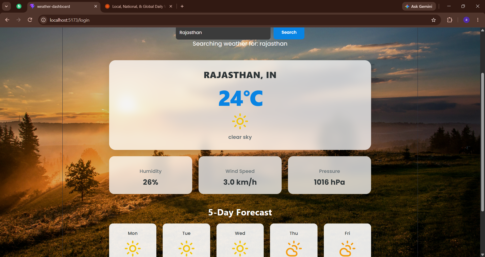
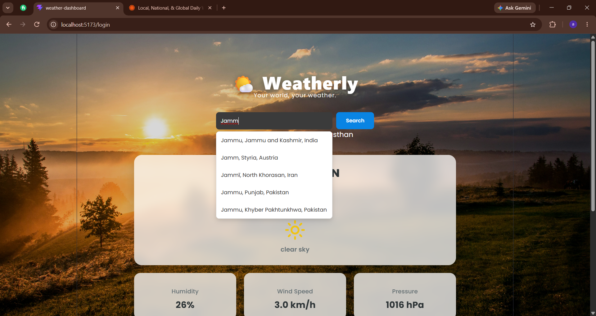
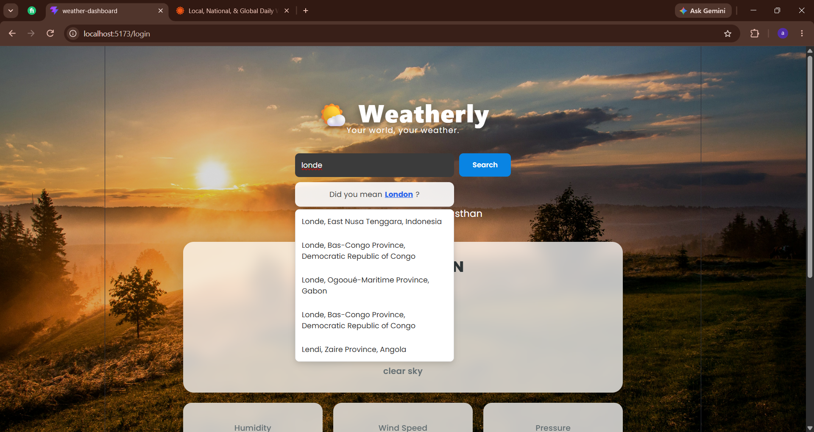

# 🌤️ Weather Dashboard

A responsive weather application built with React and TypeScript that allows users to search for cities and view real-time weather information and a five-day forecast.

## ✨ Features

- Search for weather by city.
- City autocomplete suggestions.
- Spelling correction suggestions for popular cities.
- Current temperature and weather conditions.
- Humidity, wind speed, and atmospheric pressure.
- Five-day weather forecast.
- Dynamic backgrounds based on weather conditions.
- Loading and error handling.
- Responsive design for desktop and mobile devices.

## 🛠️ Technologies Used

- React
- TypeScript
- Vite
- CSS3
- OpenWeatherMap API
- Open-Meteo Geocoding API
- Lucide React

## 📸 Screenshots

### Main Weather Dashboard

### City Autocomplete

### Spelling Correction

## ⚙️ Installation and Setup

1. Clone the repository:

   
   git clone https://github.com/asyashim/Datheon_Full_Stack_Web_Development_Internship.git
   

2. Navigate to the project folder:

   
   cd Datheon_Full_Stack_Web_Development_Internship/weather-dashboard
   

3. Install dependencies:

   
   npm install
   

4. Create a `.env.local` file in the weather-dashboard folder.

5. Add your OpenWeatherMap API key:

   
   VITE_OPENWEATHER_API_KEY=your_api_key_here
   

6. Start the development server:

   
   npm run dev
   

7. Open the local URL displayed in your terminal.

## 🏗️ Production Build

To create a production build:

npm run build

## 👩‍💻 Developer

**Asyabi C.P.**

MERN Stack Developer Trainee | React | TypeScript | Node.js